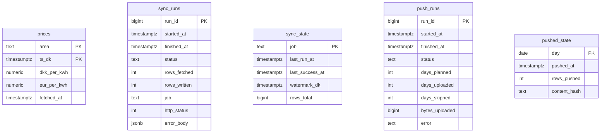
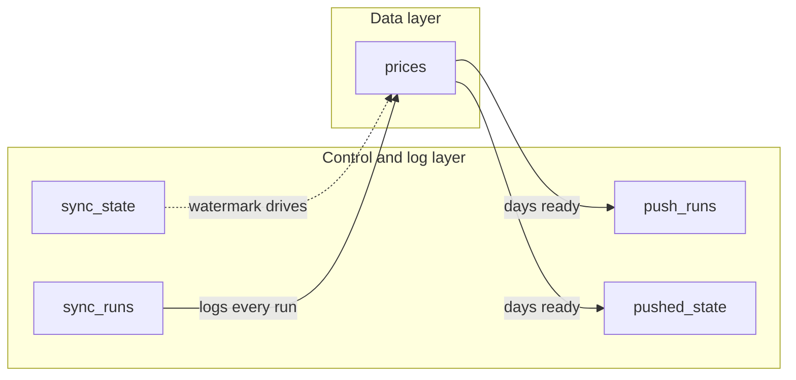

# database documentation for websolution

PostgreSQL 14 database backing the electricity-price pipeline and more. One database holds
two things: **the data we collect**, and **the log of how we collected it**.

---

## 1. What this database is for

The pipeline fetches time-series data from external sources, stores it locally on ubserv,
and pushes a daily digest out to the Regenda website hosted on Netsite. The database is
the local system of record: every fetch is logged, every push is logged, and the
collected series are stored in a shape that makes them cheap to query by time.

The database is deliberately generic. It does not know about electricity, weather,
or any other domain — the tables that hold data are named after what they hold,
and the machinery around them (runs, state, push) is domain-agnostic and reused
by every job.

---

## 2. The tables

### Data tables — what we have

| Table | Holds | Key | Growth |
|---|---|---|---|
| `prices` | Electricity spot prices per area and timestamp | `(area, ts_dk)` | One row per area per hour |

### Control and log tables — what we did

| Table | Holds | Key | Growth |
|---|---|---|---|
| `sync_runs` | One row per fetch attempt, success or failure | `run_id` | One row per job run |
| `sync_state` | Current watermark per job — where we are up to | `job` | One row per job, updated in place |
| `push_runs` | One row per push attempt to the website | `run_id` | One row per push run |
| `pushed_state` | Per day: was it pushed, how many rows, what content | `day` | One row per pushed day |

---

## 3. Diagram



### Two layers, loosely joined



**There are no foreign keys, anywhere.** This is intentional, not an oversight.
The log tables are *records of events*, not entities with relationships. They
describe what happened; the data tables describe what exists. Joining them would
add constraints that buy nothing and cost writes.

The tables are tied together by a **convention** — the `job` string — not by the
schema. See section 4.1. This is what makes it cheap to add a new data source:
you add a table and a job name. Nothing existing is migrated.


    sync_runs 
        how the collect job.py went
        djketr
    
    sync_state 
        where the collect job has got to
        This is the counterpart to pushed_state, on the other side of the pipeline. One row per job, keyed on job, updated in place
        Vandmærket er den seneste TimeDK, du med sikkerhed har indlæst  Ikke hvad vi forsøgte at hente — hvad vi faktisk fik ind
        get_watermark() returnerer None, hvis jobbet aldrig har kørt, og det None er meningsbærende, det betyder vi ved ingenting endnu, ikke vi er nået til begyndelsen
    
    push_runs 
        what we did each time
        One row per execution of the script, keyed on run_id (bigserial). This is pure append-only logging — nothing is ever updated except the row for the run in progress.
    
    pushed_state 
        what is currently out there on Netsite
        One row per calendar day that has been uploaded, keyed on day (date, primary key).
        content_hash er push-sidens svar på det samme problem, som vandmærket løser på collect-siden — bare med en anden definition af "hvad vi har".
        Push-jobbet skal kunne svare på: "er Netsites kopi af denne dag stadig aktuel?"


Et vindue ("hent de sidste 7 dage") spørger hvornår vi kører. Et vandmærke ("hent alt efter X") spørger hvad vi har. Kun det sidste overlever, at jobbet ikke kører i en periode — der er ingen kant, der kan passere ubeset, fordi der ikke er nogen kant. Der er bare en position.

Hvorfor det virker: idempotens + retning
To egenskaber bærer hele konstruktionen, og de er uafhængige af hinanden:

Fremad-retningen er håndhævet i databasen. set_watermark() bruger GREATEST(sync_state.watermark_dk, EXCLUDED.watermark_dk). Vandmærket kan ikke rulle tilbage, uanset hvad koden gør. Det gør det sikkert at kalde funktionen fra et vilkårligt sted, for enhver kørsel, med enhver rækkefølge af rækker — det værste, der kan ske, er at intet ændrer sig.

Bagud-overlapningen er håndteret af upsert. window_from = watermark - timedelta(days=2). Du henter altid to dage bagud forfra. Det ser forkert ud — hvorfor hente noget, man allerede har? — men det er nøjagtigt hvad der fanger Energinets rettelser og efterregistreringer. En pris, der blev ændret i går, ligger bag vandmærket, og uden overlapningen ville du aldrig se den.

De to mekanismer passer på hinanden: overlapningen giver dækning bagud, GREATEST forhindrer den i at skade. Hent baglæns for at fange rettelser; flyt aldrig mærket baglæns.

Og idempotensen gør gentagelsen gratis. ON CONFLICT ... DO UPDATE ... WHERE prices.dkk_per_kwh IS DISTINCT FROM EXCLUDED.dkk_per_kwh — læg mærke til WHERE-klausulen. Rækker, der ikke har ændret sig, bliver ikke skrevet overhovedet, og fetched_at røres ikke. Det er derfor, written kan være 0 for en kørsel, der hentede 5000 rækker: upserten rapporterer faktisk ændrede rækker, ikke indsatte. Overlapningen koster altså ikke skrivearbejde — kun læsearbejde.


---

## 4. Conventions

This section is the reason this file exists. The schema is machine-readable and
self-describing; these rules are not.

### 4.1 Job naming

Every job has a name, and that name is the join between the log layer and the
data layer.

- `sync_state.job` is the primary key — one row per job.
- `sync_runs.job` defaults to `'dayahead_prices'`.
- A new source gets a new job name, not a new state table.

**Convention:** `job` names are `snake_case` and describe the *thing being
fetched*, not the code path. When weather and market sources are added, each
source gets its own job name (for example `weather_dmi`, `weather_dwd`,
`market_smard`), so that one failing source cannot affect the run history of
another.

### 4.2 Idempotency

Every write into a data table is **idempotent**: running the same fetch twice
does not create duplicates and does not change the outcome.

The mechanism is a unique constraint on the natural key plus `ON CONFLICT`:

```sql
INSERT INTO prices (area, ts_dk, dkk_per_kwh, eur_per_kwh)
VALUES (%s, %s, %s, %s)
ON CONFLICT (area, ts_dk) DO UPDATE SET
    dkk_per_kwh = EXCLUDED.dkk_per_kwh,
    eur_per_kwh = EXCLUDED.eur_per_kwh,
    fetched_at  = now();
```

**Do not** key on a surrogate `id` for data tables. The natural key is the
meaning — `(area, ts_dk)` *is* what a price observation is. A surrogate id would
let duplicates in silently.

### 4.3 Timestamps

- Every data table has a `ts_dk` column: the instant the datum *applies to*.
  It is `timestamp with time zone` and it is always UTC-normalised by Postgres.
- Every data table has a `fetched_at` column: when *we* retrieved it. This is
  never the same thing as `ts_dk` and must not be confused with it.
- `sync_state.watermark_dk` is **exclusive**: it is the last instant already
  covered. A fetch requests data strictly *after* it.

### 4.4 Forecasts vs. observations — read this before adding a source

This rule does not apply to `prices` today, but it is the rule that will matter
most as weather and market sources are added, so it is written down now.

A **forecast** and an **observation** are different kinds of fact and must be
stored differently:

| Kind | What it is | Example | On re-fetch |
|---|---|---|---|
| Forecast | A prediction, made at a point in time | "12°C on Thursday at 14:00, issued Tuesday" | **Append.** Never overwrite. |
| Observation | A measurement of what happened | "11.4°C measured Thursday at 14:00" | **Upsert.** A corrected reading replaces the old one. |

The identity of a forecast includes *when it was issued*. The same target time
predicted yesterday and predicted today are two different facts, and collapsing
them destroys the history. If the key does not include an `issued_at` column,
you cannot later ask "how has the forecast moved?" — and you will want to.

**Concrete rule for new tables:** forecast rows are inserted with
`ON CONFLICT ... DO NOTHING` and a key of
`(source, location, kind, ts_dk, issued_at)`. Observation rows follow the
`prices` pattern and use `DO UPDATE`. Never mix the two into one table without a
`kind` column in the key.

Rationale: overwriting a forecast is irreversible information loss that cannot
be detected after the fact. Getting this wrong is silent — nothing breaks, you
just quietly lose the ability to answer questions later.

### 4.5 Status values

`sync_runs.status` and `push_runs.status` carry a small fixed vocabulary:

- `running` — inserted at the start of a run, `finished_at IS NULL`
- `success` — completed cleanly
- `failed` — raised an error; `error` column populated

**Invariant:** any row with `status = 'success'` or `'failed'` must have
`finished_at IS NOT NULL`. A run left in `running` is either in flight or was
killed — it is never a completed run. Use this to detect stuck jobs:

```sql
SELECT run_id, job, started_at
  FROM sync_runs
 WHERE status = 'running'
   AND started_at < now() - interval '1 hour';
```

---

## 5. Rules that are not enforced by the schema

These hold by convention. They are the ones most likely to be violated by a
future change, so they are stated explicitly.

1. **One job name per source.** Never make two different sources share a
   `sync_state` row or a `sync_runs.job` value. Isolation is the point.
2. **Never overwrite a forecast.** See 4.4.
3. **`fetched_at` is never backdated.** It records reality, not intent.
4. **The `prices` table is append-and-update only.** Rows are never deleted by
   application code; retention is a separate, explicit operation (section 7).
5. **`pushed_state.content_hash` is the deduplication key.** A day is only
   re-pushed when its content changes. This is what makes daily pushes cheap and
   safe to retry.
6. **Schema changes go through `schema.sql`.** The live database is recreated
   from the dump; the dump is the artefact under version control.

---

## 6. Creating and verifying

The database runs on the local Ubuntu server. The service to check is the
versioned cluster, **not** `postgresql.service` — that unit is a wrapper whose
only job is to exit successfully, so it always reports `active (exited)` even
when no database is listening.

```bash
# The authoritative overview: version, cluster, port, status, data dir
pg_lsclusters

# Confirm something is actually listening on the port
ss -tlnp | grep 5432

# Confirm the cluster unit is the running one
systemctl status postgresql@14-main
```

Create the schema from the dump:

```bash
psql -h localhost -U postgres -d pricejob -f schema.sql
```

Verify the connection and the server version:

```bash
sudo -u postgres psql -c 'select version();'
```

Expect PostgreSQL 14 (`Ubuntu 14.24-0ubuntu0.22.04.1`) — the version the dump was
taken from.

---

## 7. Retention

Not yet a problem: with one table and one job, growth is trivial. It becomes a
problem when multiple sources and locations are added, because forecast rows are
append-only by design and therefore grow without bound.

The decision to make, in order of preference:

1. **Keep everything, revisit later.** Simplest, and it is not yet known which
   history will be useful. Add a materialised view if queries get slow.
2. **Roll up old forecasts.** After some window (for example 30 days), keep only
   the last forecast per `(source, location, ts_dk)` and drop the rest. Loses
   historical forecast uncertainty, keeps a usable history.
3. **Partition on `ts_dk`** and drop old partitions. Consider only if growth
   reaches the hundreds-of-thousands-of-rows-per-day range.

Document the chosen strategy here once decided.

---

## 8. Extending

To add a data source, four things, in this order:

1. **A table** in `schema.sql`, with a natural key containing `ts_dk`, a
   `fetched_at`, and idempotent write semantics (4.2, 4.4).
2. **A job name**, unique to that source (4.1).
3. **A sync function** that opens a `sync_runs` row, writes data, updates
   `sync_state`, and closes the run — success or failure.
4. **An API endpoint** reading the new table, shaped for the frontend.

Nothing in the existing tables changes. That is the property that makes this
design worth keeping.
